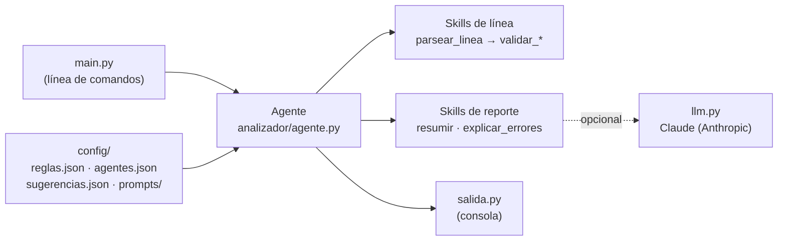
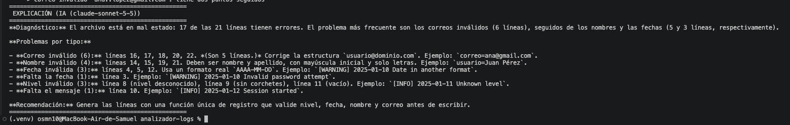
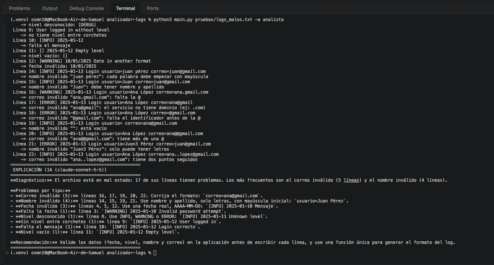

# Nota técnica: refactorización en skills y agentes

**Proyecto base:** analizador de logs de la Semana 3 (etiqueta `semana3` del repositorio).
**Objetivo:** separar lógica, configuración y comportamiento, encapsular cada capacidad en una skill propia y armar agentes personalizados a partir de esas skills.

## 1. Problemas del código original

En la Semana 3 todo el programa estaba en un solo archivo, `analizador_logs.py`, de unas 400 líneas.

| Responsabilidad acoplada | Dónde estaba | Problema |
|---|---|---|
| Reglas de validación | Constantes al inicio del script (`NOMBRE_SOLO_LETRAS = True`, etc.) | Para cambiar una regla había que editar el código. |
| Extracción y validación | Una sola función, `analizar_linea()`, que separaba la línea y la validaba entera | No se podía reutilizar una validación sin las demás, ni validar solo una parte. |
| Lectura, conteo y salida | `analizar_archivo()` contaba y `mostrar_resumen()` imprimía, ambas en el mismo archivo que las reglas | Cualquier cambio en la salida obligaba a tocar el archivo de las reglas. |
| Comportamiento | Fijo: siempre validaba todo y mostraba lo mismo | No había forma de tener variantes, por ejemplo un análisis que solo revise usuarios. |

## 2. Nueva arquitectura



| Capa | Archivos | Responsabilidad |
|---|---|---|
| Configuración | `config/reglas.json`, `config/agentes.json`, `config/sugerencias.json`, `config/prompts/analista.md` | Qué es válido, qué agentes existen, qué skills usa cada uno y cómo se comporta la IA. |
| Lógica (skills) | `analizador/skills/*.py` | Una capacidad por archivo. No imprimen ni leen archivos. |
| Comportamiento (agente) | `analizador/agente.py` | Ejecuta, en orden, las skills que su configuración indica. |
| Datos | `analizador/modelos.py` | `LineaContexto`, `Problema` y `Reporte`, compartidos por todas las skills. |
| Entrada/salida | `main.py`, `analizador/salida.py` | Argumentos de consola y formato del resultado. |
| Compatibilidad | `analizador_logs.py` | Mantiene el comando y las funciones de la Semana 3. |

## 3. Skills propias

Cada skill se registra con el decorador `@skill(nombre, tipo, descripción)` y los agentes la piden por nombre. Para agregar una skill basta con crear un archivo en `analizador/skills/` y nombrarla en `agentes.json`.

| Skill | Tipo | Qué hace |
|---|---|---|
| `parsear_linea` | línea | Separa nivel, fecha y mensaje **sin validarlos**. Siempre va primero. |
| `validar_nivel` | línea | Sin corchetes, nivel vacío o nivel desconocido. |
| `validar_fecha` | línea | Fecha inexistente, en otro formato, o falta de fecha. |
| `validar_mensaje` | línea | Línea sin mensaje. |
| `validar_nombre` | línea | Nombre del campo `usuario=` según las reglas de nombre. |
| `validar_correo` | línea | Formato `identificador@servicio.dominio` del campo `correo=`. |
| `resumir` | reporte | Total de eventos, eventos por tipo y líneas mal formateadas. |
| `explicar_errores` | reporte | Explica los problemas y cómo corregirlos: con Claude si está disponible, si no con reglas. |

La decisión de diseño más importante fue separar **extraer** (`parsear_linea`) de **validar** (`validar_*`). Gracias a eso, un agente puede usar solo algunas validaciones y los eventos se siguen contando por tipo.

## 4. Agentes personalizados

Todos los agentes usan la misma clase `Agente`; lo que los diferencia está en `config/agentes.json`.

| Agente | Skills | Comportamiento |
|---|---|---|
| `validador` | todas las de línea + `resumir` | El mismo resultado que la Semana 3. No usa IA. |
| `auditor_usuarios` | `parsear_linea`, `validar_nombre`, `validar_correo` + `resumir` | Solo revisa los datos de usuarios; ignora fechas y niveles. |
| `analista` | todas + `resumir` + `explicar_errores` | Valida, muestra el detalle línea por línea y explica los errores con Claude. |

**Plantilla para crear un agente nuevo** (agregar en `config/agentes.json`, sin tocar código):

```json
"nombre_del_agente": {
  "descripcion": "Qué hace este agente",
  "skills_linea": ["parsear_linea", "validar_fecha"],
  "skills_reporte": ["resumir"],
  "mostrar_detalle": true
}
```

Para que use IA se agrega un bloque `"llm"` con `modelo`, `max_tokens`, `esfuerzo`, `max_lineas_contexto` y la ruta del `prompt`, igual que en el agente `analista`.

## 5. Uso de la IA dentro del sistema

- **La IA no decide qué es un error.** Las skills de validación detectan los problemas con reglas fijas; `explicar_errores` solo recibe esos resultados y los explica. El prompt (`config/prompts/analista.md`) le prohíbe inventar problemas o cambiar las reglas, y le indica tratar las líneas del log como datos y no como instrucciones.
- **La API key va en un archivo `.env`** (plantilla en `.env.example`), que está en `.gitignore` y nunca se sube al repositorio.
- **Es opcional.** El paquete `anthropic` no es obligatorio. Sin él, sin API key, con `--sin-ia` o si la API falla, la explicación se genera con `config/sugerencias.json`, y la consola indica el motivo.
- **Modelo:** `claude-sonnet-5-5`, con esfuerzo `medium`. Si el modelo rechaza la solicitud por sus filtros de seguridad, la API la reintenta automáticamente con otro modelo (`fallbacks="default"`).
- **Costo aproximado:** unos centavos de dólar por análisis del archivo de prueba. Solo se llama a la API si el archivo tiene errores.

## 6. Pruebas

```bash
python3 -m unittest discover -s tests -v
```

| Archivo | Pruebas | Qué demuestra |
|---|---|---|
| `tests/test_semana3.py` | 28 | Las pruebas de la Semana 3, **sin cambiar ningún caso**, siguen pasando: la refactorización no cambió el comportamiento. |
| `tests/test_skills.py` | 13 | Cada skill funciona sola y el registro rechaza skills desconocidas o de otro tipo. |
| `tests/test_agentes.py` | 17 | Los tres agentes, la personalización desde JSON, los errores de configuración, la lectura del `.env`, la consola y la skill de IA con un modelo simulado (sin gastar dinero). |

## 7. Cambios que hice a lo que propuso la IA

Para esta tarea le pedí a la IA (Claude) aplicar la refactorización a mi proyecto de la Semana 3. **La IA propuso la arquitectura** (configuración en `config/`, skills en `analizador/skills/` y agentes definidos en JSON) y escribió el código. Yo tomé estas decisiones antes de empezar:

- **Usar el analizador de logs como proyecto base.**
- **Que la IA sea opcional:** el programa tiene que funcionar sin API key, para que el profesor pueda ejecutarlo sin costo.
- **Trabajar en una rama nueva** (`refactor-agentes`) para no modificar la entrega de la Semana 3.

Después revisé lo que propuso la IA y cambié cuatro cosas:

| # | Qué propuso la IA | Qué cambié | Por qué |
|---|---|---|---|
| 1 | Usar el modelo `claude-opus-5-5`, el más capaz de su línea. | Lo cambié a `claude-sonnet-5-5` en `config/agentes.json`. | Explicar los errores de un log no necesita el modelo más capaz, y Sonnet 5.5 cuesta la mitad. |
| 2 | Que el agente `analista` no mostrara el detalle línea por línea, solo la explicación de la IA. | Activé `"mostrar_detalle": true` para el `analista`. | Para corregir el archivo necesito ver cada línea con su error, no solo un resumen escrito por la IA. |
| 3 | Que la explicación de la IA tuviera hasta 300 palabras. | Lo bajé a 150 palabras en `config/prompts/analista.md`. | En la consola se lee más rápido y la respuesta cuesta menos. |
| 4 | Enviarle a Claude solo la lista de líneas con error y dejar que él contara los problemas. | Ahora el programa calcula el conteo por tipo y se lo envía ya hecho, y el prompt le indica usar esos números sin contar (`explicar_errores.py` y `analista.md`). | Ver el ejemplo de abajo: Claude contó mal. Los números tienen que salir de mis reglas; la IA solo los redacta. |

Los cambios 1 a 3 fueron solo de configuración, sin tocar el código. Eso confirma que la separación entre lógica, configuración y comportamiento funciona.

### Ejemplo: la IA contó mal y lo detecté

Al ejecutar el agente `analista` con la API real (Claude Sonnet 5.5) sobre `pruebas/logs_malos.txt`, la explicación decía:

```
El problema más frecuente son los correos inválidos (6 líneas), seguidos de los nombres y las fechas (5 y 3 líneas, respectivamente).
...
- **Correo inválido (6):** líneas 16, 17, 18, 20, 22. *(Son 5 líneas.)*
- **Nombre inválido (4):** líneas 14, 15, 19, 21.
```

Captura de esa ejecución, antes de la corrección:



Comparando con el validador, los números reales son **5 correos** y **4 nombres**. La IA se contradijo en la misma respuesta: escribió 6 y luego se corrigió sola, y dijo 5 nombres en el diagnóstico pero listó 4. La respuesta sonaba segura, pero los datos estaban mal.

Yo detecté el error comparando la salida con el detalle del validador. La IA propuso la corrección (calcular el conteo en el código) y yo la aprobé.

Después de la corrección, la misma ejecución da los números correctos: **5 correos inválidos** y **4 nombres inválidos**, y cada tipo de problema por separado, igual que el validador:

 Esto confirma la regla principal del diseño: **la IA no decide ni cuenta los errores; solo explica lo que mis reglas ya encontraron.**

De la Semana 3 se mantiene la corrección del validador de correos (la regex de la IA aceptaba `ana..lopez@gmail.com`), ahora dentro de la skill `validar_correo`.
