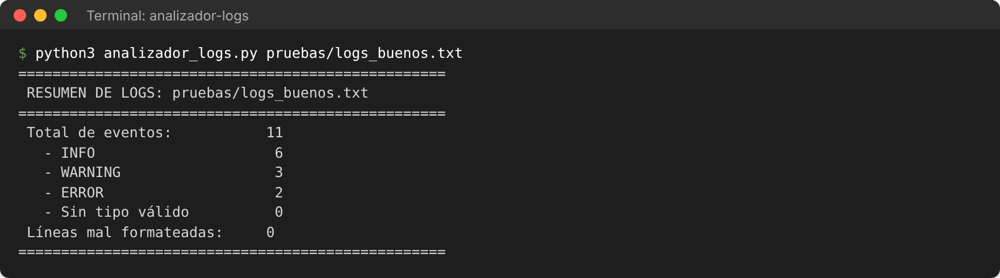
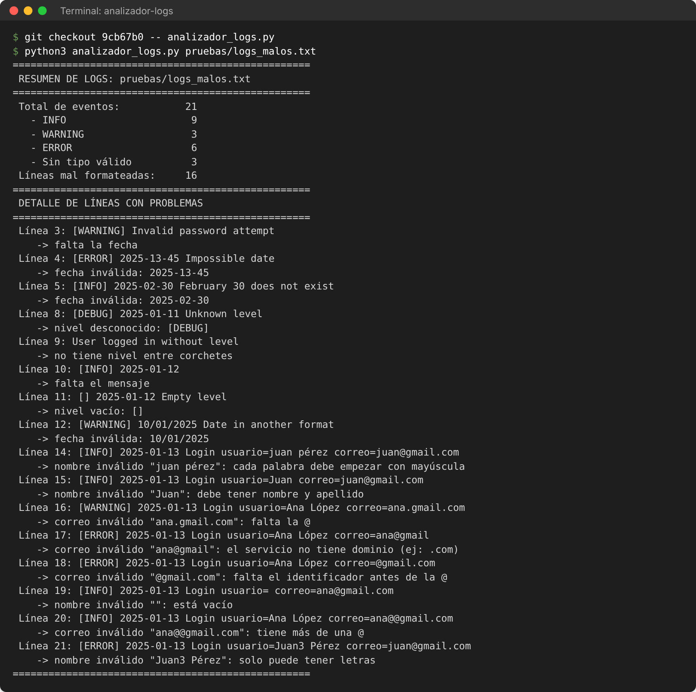
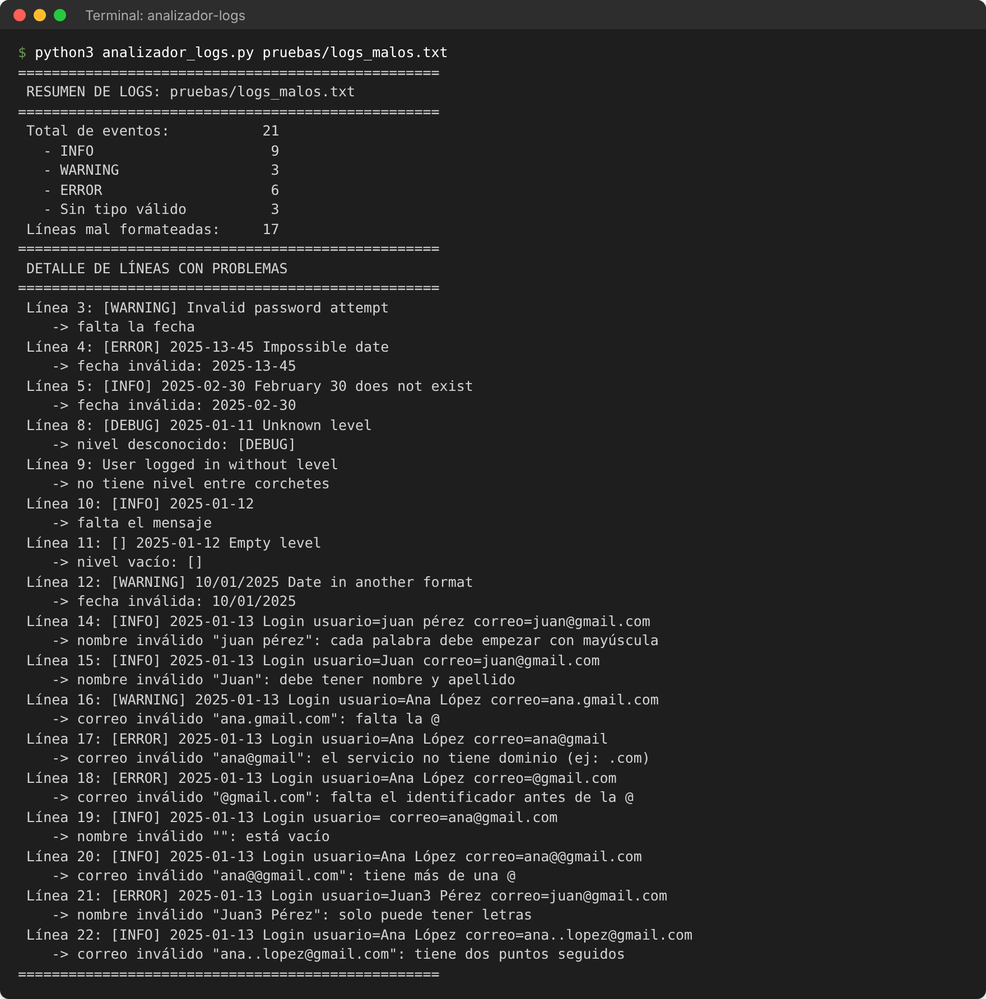
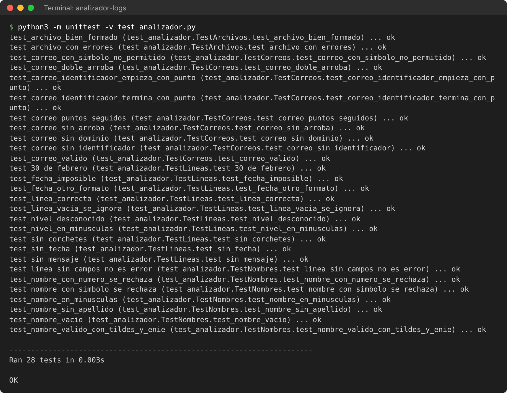

# Analizador de logs

Script en Python que analiza un archivo de texto con registros de eventos (logs) y muestra en consola:

- Total de eventos
- Cantidad de eventos por tipo (INFO / WARNING / ERROR)
- Número de líneas mal formateadas o incompletas, con el motivo de cada una

## Requisitos

- Python 3.8 o superior
- No necesita librerías externas (solo `re`, `datetime`, `pathlib`, `sys`)

## Cómo ejecutarlo

> En Mac (y algunos Linux) el comando se llama `python3` en vez de `python`.

Para indicar el archivo al ejecutar:

```bash
python analizador_logs.py pruebas/logs_buenos.txt
```

Sin argumentos, el programa pregunta la ruta:

```bash
python analizador_logs.py
```

Para ejecutar las pruebas automáticas:

```bash
python -m unittest -v test_analizador.py
```

## Estructura del proyecto

```
analizador-logs/
├── analizador_logs.py           # Script principal
├── test_analizador.py           # Pruebas automáticas (28 casos)
├── pruebas/
│   ├── logs_buenos.txt          # Archivo bien formado
│   ├── logs_malos.txt           # Archivo con errores e inconsistencias
│   └── vacio.txt                # Archivo vacío
├── capturas/                    # Capturas de la ejecución (ver abajo)
├── README.md                    # Este archivo (uso y evidencias de pruebas)
├── REFLEXION.md                 # Reflexión técnica en texto
└── Informe_analizador_logs.docx # Documento de reflexión técnica (Word)
```

## Formato esperado de cada línea

```
[NIVEL] AAAA-MM-DD mensaje
```

## Reglas de validación

Una línea se considera **mal formateada o incompleta** si:

| Caso | Ejemplo | ¿Cuenta en su tipo? |
|---|---|---|
| No tiene nivel entre corchetes | `User logged in` | No |
| Nivel vacío | `[] 2025-01-12 ...` | No |
| Nivel desconocido | `[DEBUG] 2025-01-11 ...` | No |
| Falta la fecha | `[WARNING] Invalid password attempt` | Sí (WARNING) |
| Fecha imposible | `[ERROR] 2025-13-45 ...` | Sí (ERROR) |
| Fecha en otro formato | `[WARNING] 10/01/2025 ...` | Sí (WARNING) |
| Falta el mensaje | `[INFO] 2025-01-12` | Sí (INFO) |
| Nombre inválido en `usuario=` | `... usuario=juan pérez` | Sí |
| Correo inválido en `correo=` | `... correo=ana.gmail.com` | Sí |

### Nombres propios (campo `usuario=`)

El nombre se busca en el campo `usuario=` y termina donde empieza el siguiente campo (`correo=`) o al final de la línea.

```
[INFO] 2025-01-13 Login usuario=María Muñoz correo=maria.munoz@gmail.com
```

| Regla | Válido | Inválido |
|---|---|---|
| Cada palabra empieza con mayúscula | `Juan Pérez` | `juan pérez` |
| Se aceptan tildes y ñ | `María Muñoz`, `Ángel` | — |
| Mínimo nombre y apellido | `Juan Pérez` | `Juan` |
| No puede estar vacío | — | `usuario=` |
| Solo letras (sin números ni símbolos) | `Juan Pérez` | `Juan3 Pérez`, `Juan_P Pérez` |

### Correos electrónicos (campo `correo=`)

Formato: `identificador @ servicio.dominio`, por ejemplo `juan.perez@gmail.com`.

| Caso | Ejemplo | Motivo que se muestra |
|---|---|---|
| Sin arroba | `ana.gmail.com` | falta la @ |
| Más de una arroba | `ana@@gmail.com` | tiene más de una @ |
| Sin identificador | `@gmail.com` | falta el identificador antes de la @ |
| Sin servicio | `ana@` | falta el servicio después de la @ |
| Sin dominio | `ana@gmail` | el servicio no tiene dominio (ej: .com) |
| Dos puntos seguidos | `ana..lopez@gmail.com` | tiene dos puntos seguidos |
| Identificador empieza o termina con punto | `.ana@gmail.com`, `ana.@gmail.com` | el identificador no puede empezar ni terminar con punto |
| Símbolos raros o dominio de 1 letra | `ana!@gmail.com`, `ana@gmail.c` | caracteres no permitidos o dominio inválido |

Si una línea **no trae** los campos `usuario=` o `correo=`, no es un error, porque no todos los eventos involucran a un usuario.

Otros casos:

- **Líneas vacías:** se ignoran. No son eventos ni errores.
- **Nivel en minúsculas** (`[info]`): se acepta y se cuenta como INFO.
- **Archivo inexistente o vacío:** se muestra un mensaje claro y el programa no falla.

> Todas estas reglas se configuran al inicio de `analizador_logs.py`, en la sección "REGLAS DE VALIDACIÓN". La justificación de cada una está en `REFLEXION.md`.

---

## Evidencia de pruebas

### Prueba 1: archivo bien formado (`pruebas/logs_buenos.txt`)

Contiene 11 líneas, todas con el formato correcto. Tres de ellas traen nombres y correos válidos, incluidos tildes, ñ y un dominio de varias partes (`empresa.com.sv`).

| Dato | Esperado | Obtenido |
|---|---|---|
| Total de eventos | 11 | 11 ✅ |
| INFO | 6 | 6 ✅ |
| WARNING | 3 | 3 ✅ |
| ERROR | 2 | 2 ✅ |
| Mal formateadas | 0 | 0 ✅ |

Salida obtenida:

```
==================================================
 RESUMEN DE LOGS: pruebas/logs_buenos.txt
==================================================
 Total de eventos:           11
   - INFO                     6
   - WARNING                  3
   - ERROR                    2
   - Sin tipo válido          0
 Líneas mal formateadas:     0
==================================================
```

### Prueba 2: archivo con errores (`pruebas/logs_malos.txt`)

Contiene 22 líneas: 1 vacía, 4 correctas y 17 con algún problema.

| Línea | Contenido | Resultado esperado |
|---|---|---|
| 1 | `[INFO] 2025-01-10 User logged in` | Válida |
| 2 | `[ERROR] 2025-01-10 Failed to connect...` | Válida |
| 3 | `[WARNING] Invalid password attempt` | Falta la fecha |
| 4 | `[ERROR] 2025-13-45 Impossible date` | Fecha inválida (mes 13) |
| 5 | `[INFO] 2025-02-30 ...` | Fecha inválida (30 de febrero) |
| 6 | `[info] 2025-01-11 Lowercase level` | Válida (minúsculas aceptadas) |
| 7 | *(vacía)* | Ignorada |
| 8 | `[DEBUG] 2025-01-11 Unknown level` | Nivel desconocido |
| 9 | `User logged in without level` | Sin nivel |
| 10 | `[INFO] 2025-01-12` | Falta el mensaje |
| 11 | `[] 2025-01-12 Empty level` | Nivel vacío |
| 12 | `[WARNING] 10/01/2025 ...` | Fecha en otro formato |
| 13 | `[ERROR] 2025-01-12 Disk full` | Válida |
| 14 | `[INFO] ... usuario=juan pérez correo=juan@gmail.com` | Nombre sin mayúscula inicial |
| 15 | `[INFO] ... usuario=Juan correo=juan@gmail.com` | Nombre sin apellido |
| 16 | `[WARNING] ... usuario=Ana López correo=ana.gmail.com` | Correo sin @ |
| 17 | `[ERROR] ... usuario=Ana López correo=ana@gmail` | Correo sin dominio |
| 18 | `[ERROR] ... usuario=Ana López correo=@gmail.com` | Correo sin identificador |
| 19 | `[INFO] ... usuario= correo=ana@gmail.com` | Nombre vacío |
| 20 | `[INFO] ... usuario=Ana López correo=ana@@gmail.com` | Correo con doble @ |
| 21 | `[ERROR] ... usuario=Juan3 Pérez correo=juan@gmail.com` | Nombre con número |
| 22 | `[INFO] ... usuario=Ana López correo=ana..lopez@gmail.com` | Correo con dos puntos seguidos |

| Dato | Esperado | Obtenido |
|---|---|---|
| Total de eventos (sin contar la vacía) | 21 | 21 ✅ |
| INFO (líneas 1, 5, 6, 10, 14, 15, 19, 20, 22) | 9 | 9 ✅ |
| WARNING (líneas 3, 12, 16) | 3 | 3 ✅ |
| ERROR (líneas 2, 4, 13, 17, 18, 21) | 6 | 6 ✅ |
| Sin tipo válido (líneas 8, 9, 11) | 3 | 3 ✅ |
| Mal formateadas | 17 | 17 ✅ |

Salida obtenida:

```
==================================================
 RESUMEN DE LOGS: pruebas/logs_malos.txt
==================================================
 Total de eventos:           21
   - INFO                     9
   - WARNING                  3
   - ERROR                    6
   - Sin tipo válido          3
 Líneas mal formateadas:     17
==================================================
 DETALLE DE LÍNEAS CON PROBLEMAS
==================================================
 Línea 3: [WARNING] Invalid password attempt
    -> falta la fecha
 Línea 4: [ERROR] 2025-13-45 Impossible date
    -> fecha inválida: 2025-13-45
 Línea 5: [INFO] 2025-02-30 February 30 does not exist
    -> fecha inválida: 2025-02-30
 Línea 8: [DEBUG] 2025-01-11 Unknown level
    -> nivel desconocido: [DEBUG]
 Línea 9: User logged in without level
    -> no tiene nivel entre corchetes
 Línea 10: [INFO] 2025-01-12
    -> falta el mensaje
 Línea 11: [] 2025-01-12 Empty level
    -> nivel vacío: []
 Línea 12: [WARNING] 10/01/2025 Date in another format
    -> fecha inválida: 10/01/2025
 Línea 14: [INFO] 2025-01-13 Login usuario=juan pérez correo=juan@gmail.com
    -> nombre inválido "juan pérez": cada palabra debe empezar con mayúscula
 Línea 15: [INFO] 2025-01-13 Login usuario=Juan correo=juan@gmail.com
    -> nombre inválido "Juan": debe tener nombre y apellido
 Línea 16: [WARNING] 2025-01-13 Login usuario=Ana López correo=ana.gmail.com
    -> correo inválido "ana.gmail.com": falta la @
 Línea 17: [ERROR] 2025-01-13 Login usuario=Ana López correo=ana@gmail
    -> correo inválido "ana@gmail": el servicio no tiene dominio (ej: .com)
 Línea 18: [ERROR] 2025-01-13 Login usuario=Ana López correo=@gmail.com
    -> correo inválido "@gmail.com": falta el identificador antes de la @
 Línea 19: [INFO] 2025-01-13 Login usuario= correo=ana@gmail.com
    -> nombre inválido "": está vacío
 Línea 20: [INFO] 2025-01-13 Login usuario=Ana López correo=ana@@gmail.com
    -> correo inválido "ana@@gmail.com": tiene más de una @
 Línea 21: [ERROR] 2025-01-13 Login usuario=Juan3 Pérez correo=juan@gmail.com
    -> nombre inválido "Juan3 Pérez": solo puede tener letras
 Línea 22: [INFO] 2025-01-13 Login usuario=Ana López correo=ana..lopez@gmail.com
    -> correo inválido "ana..lopez@gmail.com": tiene dos puntos seguidos
==================================================
```

### Prueba 3: archivo que no existe

```
$ python analizador_logs.py no_existe.txt
Error: el archivo 'no_existe.txt' no existe.
```

Resultado esperado: un mensaje claro, sin traceback de Python. ✅

### Prueba 4: archivo vacío

```
$ python analizador_logs.py pruebas/vacio.txt
El archivo 'pruebas/vacio.txt' no contiene eventos.
```

Resultado esperado: el programa avisa y no muestra un resumen en ceros. ✅

### Pruebas automáticas

```
$ python -m unittest -v test_analizador.py
...
Ran 28 tests in 0.004s

OK
```

### Capturas de la ejecución

Salida de consola al ejecutar el programa con los archivos de prueba.

**1. Archivo bien formado:** 11 eventos y 0 líneas mal formateadas.



**2. Antes de la corrección de correos:** se usa la versión anterior del código, recuperada del historial de git (commit `9cb67b0`). Hay 16 líneas mal formateadas y la línea 22 (`ana..lopez@gmail.com`) no aparece, aunque el correo es inválido.



**3. Después de la corrección:** la línea 22 aparece con "tiene dos puntos seguidos" y hay 17 líneas mal formateadas.



**4. Pruebas automáticas:** `Ran 28 tests` y `OK`.


